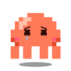
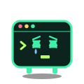

<p align="center">
  
  
  
  
</p>

<h1 align="center">Agent Zoo</h1>

<p align="center">A desktop home for your coding agents. Run <b>Claude Code</b>, <b>Codex</b> and <b>Grok</b> in one app, with real tool cards, diffs, one-click approvals and a mascot that reacts to what the agent is doing.</p>

---

## What it does

Agent Zoo drives the agent CLIs you already have installed, through their own machine interfaces, and draws the session as an interface instead of terminal text:

- **Tool cards:** shell commands with live output and exit status, edits as diffs with line numbers, file reads, searches and to-do lists.
- **Inline approvals:** see the command or the diff, then choose *Allow once*, *Always allow* or *Deny*.
- **Streaming replies** in markdown, with collapsible thinking.
- **Context and cost** at a glance, plus the agent's plan in a side panel.
- **A skin for each agent:** warm coral for Claude, mint on graphite for Codex, neon violet on black for Grok. Light and dark follow your system.
- **Mascots** that sit on the input box and react to the session: idle, thinking, working, waiting for approval, done, or error.

| Agent | How Agent Zoo talks to it |
|---|---|
| Claude Code | `claude -p` in two-way stream-json mode |
| Codex | `codex app-server` (JSON-RPC) |
| Grok | `grok agent stdio` (Agent Client Protocol) |

The details are in [`docs/PROTOCOLS.md`](docs/PROTOCOLS.md).

## Status

Early but working. All three agents run end to end. Coming next: a **Terminal** tab for each session, so nothing from the agents' own terminal interfaces is ever out of reach; a `/` command menu; session history; and user mascot packs. See [`PLAN.md`](PLAN.md).

## Run it

You need Node 20 or later and at least one of `claude`, `codex` or `grok` installed and logged in.

```bash
npm install
npm run dev
```

On Ubuntu and some other Linux distributions, Electron needs its sandbox helper owned by root once after install:

```bash
sudo chown root:root node_modules/electron/dist/chrome-sandbox
sudo chmod 4755 node_modules/electron/dist/chrome-sandbox
```

### Replay mode

Replay mode plays a recorded session through the real interface without spending tokens. It's handy for theme and mascot work:

```bash
python3 tools/record_claude.py sandbox fixtures/claude-twoway.ndjson   # record once (also record_codex.py, record_grok.py)
AGENTS_GUI_REPLAY=fixtures/claude-twoway.ndjson npm run dev
```

Recordings contain details of your local setup, so they are git-ignored.

### Tests

```bash
npm test        # adapter replay tests; the ones that need recordings skip when none are present
npm run typecheck
```

## Mascots

Each mascot is a **pack**: a folder with `mascot.json` and `mascot.svg`. The SVG uses a shared set of class names (`.body`, `.eyes`, `.e-open`, `.e-happy`, `.e-x`, `.e-sad`, and so on), and the app animates every state from CSS, so a pack contains no code. The built-in packs are in [`src/renderer/src/mascots/packs`](src/renderer/src/mascots/packs). Loading your own packs from `~/.config/agent-zoo/mascots` is on the roadmap.

## Disclaimer

Agent Zoo is an independent project. It is not affiliated with or endorsed by Anthropic, OpenAI or xAI. Claude, Codex and Grok are trademarks of their respective owners. All mascots are original artwork.

## License

[MIT](LICENSE)
